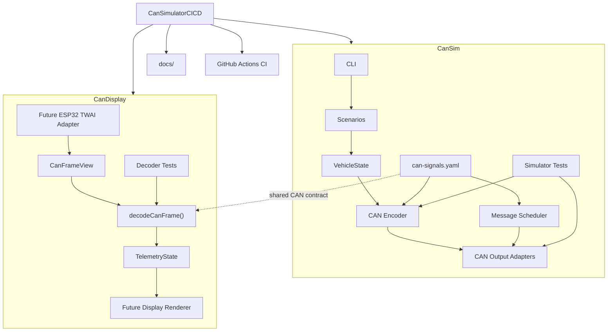
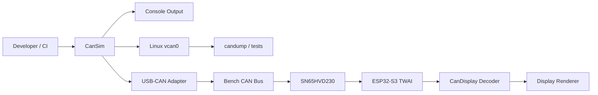
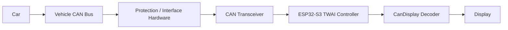
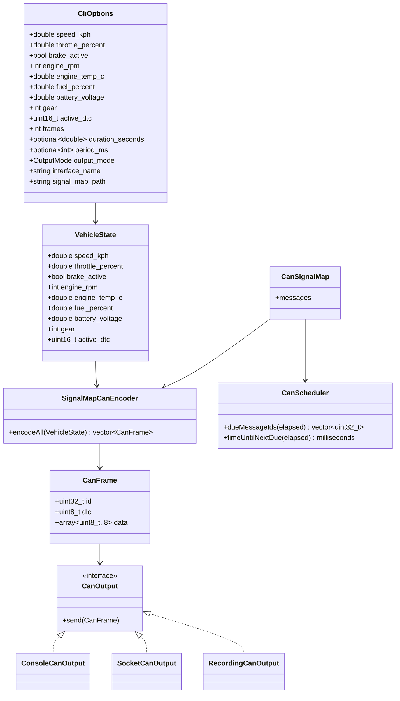
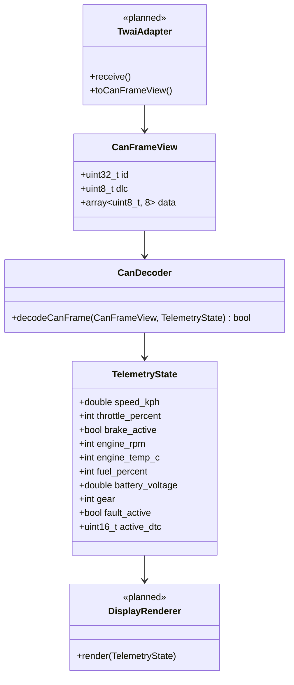
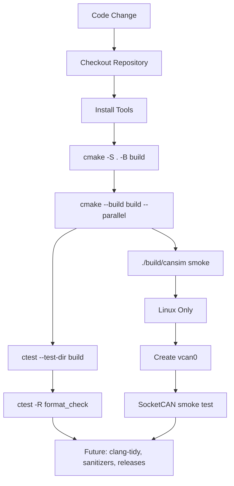

# Architecture Diagrams

Last updated: 2026-10-02

## Status

Partly implemented.

These diagrams show the current repo shape and the intended hardware path. `CanSim` and the portable `CanDisplay` decoder exist today. ESP32 TWAI glue and display rendering are planned next.

## Repository Diagram

## Development Data Flow

## Final Hardware Path

## Simulator Component Diagram

## Display Decoder Diagram

## CI/CD Diagram

