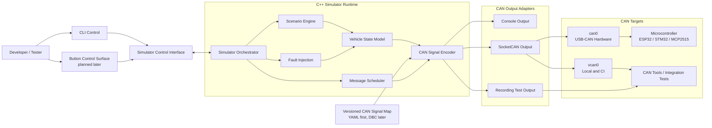
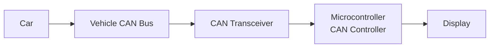
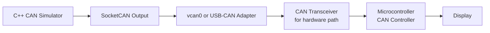
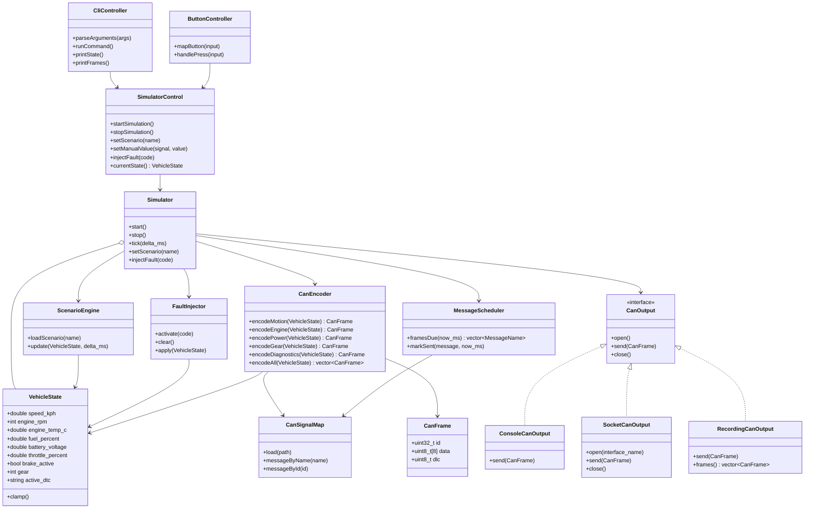
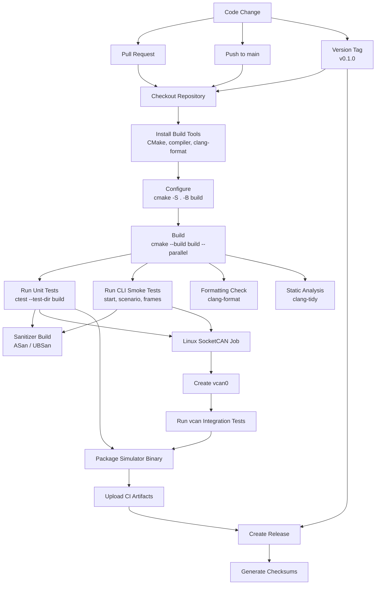

# Architecture Diagrams

## Status

Planned.

## System Diagram

## Target Hardware Diagram

## Simulator Development Path

## Class Diagram

## CI/CD Implementation Diagram

## CI/CD Timing Recommendation

CI/CD should begin as soon as the first compileable function and its first test exist.

The first pipeline should be intentionally small:

- configure the CMake project
- build the simulator library or executable
- run the first unit test
- optionally check formatting

The reason is practical: CI/CD is easiest when it grows with the project. If it is added after many features already exist, the team has to debug the application and the pipeline at the same time. Starting early makes every later feature pass through the same build and test path from the beginning.

Recommended order:

1. Create the project skeleton.
2. Add the first pure function, such as CAN speed encoding.
3. Add a unit test for that function.
4. Add the first CI workflow that builds and runs the test.
5. Expand CI as the architecture expands.

Do not wait for SocketCAN, the button control surface, packaging, or hardware support before adding CI. Those should be added as later CI stages once the matching project capability exists.
